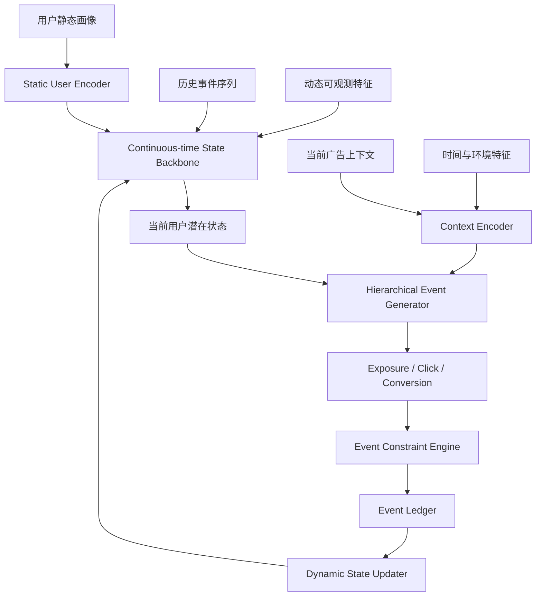

# AdCSPP：广告流量因果状态空间生成模型设计文档

**Advertising Causal State-space Point Process**

|                                                                                                                                                                                                                               |
|:------------------------------------------------------------------------------------------------------------------------------------------------------------------------------------------------------------------------------|
| 项目 \| 内容 \| — \| — \| 文档版本 \| V1.1 \| 文档状态 \| 设计方案 \| 模型名称 \| AdCSPP \| 模型类型 \| 连续时间、状态驱动、事件约束的广告用户行为生成模型 \| 核心技术 \| State-Space Point Process、Marked Temporal Point \| |
| Process、生存分析、有限状态机                                                                                                                                                                                                 |
| 开发框架 Python / TensorFlow                                                                                                                                                                                                  |
| 首期范围 给定曝光条件下生成点击、未点击和延迟转化                                                                                                                                                                             |
| 后续范围 自主生成曝光机会、广告选择及完整用户流量                                                                                                                                                                             |
| 原有方案 VAE + DDPM                                                                                                                                                                                                           |

> **本版修订说明**
>
> 本文从 AdCSPP
> 的建模需求出发定义输入、输出和特征，不依赖任何现有线上特征字段，也不包含线上字段映射。所有特征名称均为模型内部建议命名。具体数据源、字段映射和工程接入方式应在模型设计确定后单独制定。

------------------------------------------------------------------------

# 1. 项目背景与建设目标

## 1.1 项目背景

现有广告流量仿真方案采用 VAE +
DDPM，通过学习历史广告话单的联合分布生成模拟数据。该方案可以拟合部分特征的统计分布，但在生成完整用户行为轨迹时存在不足：

1.  **静态特征与动态特征缺乏一致性。**
    用户性别、设备、地域等相对稳定的属性应在同一用户的生成轨迹中保持一致；曝光次数、点击次数、近期活跃程度等动态特征则应由实际生成的事件驱动更新。
2.  **事件之间缺少业务约束。**
    点击必须关联一条有效曝光；点击时间不能早于曝光时间；点击后转化必须关联有效点击，且转化时间不能早于点击时间。
3.  **用户行为的长期依赖不足。**
    历史曝光、点击、转化会影响用户后续的活跃程度、广告疲劳、兴趣和转化倾向。
4.  **难以支持策略干预。**
    仅生成统计分布相似的话单，无法充分支持不同广告位、广告、素材和曝光策略下的用户行为模拟。
5.  **长序列生成容易产生状态漂移。**
    单条话单看似合理，并不意味着连续生成数小时或数天后仍能保持合理的用户状态和行为分布。

因此，需要将生成对象从独立话单调整为完整的用户行为轨迹。

## 1.2 建设目标

AdCSPP
将广告流量生成建模为连续时间、状态驱动、事件约束的用户行为生成过程。

主要目标：

- 以用户为主体生成完整行为轨迹，而不是独立生成每条话单。
- 用户静态画像在单次仿真周期内保持稳定。
- 用户动态状态随时间和行为事件演化。
- 曝光、点击、转化通过明确的事件关联关系连接。
- 通过硬约束保证行为链路和时间顺序合法。
- 支持用户级、多曝光并发和长时间范围的行为模拟。
- 为后续广告策略干预、反事实模拟和强化学习提供环境接口。

## 1.3 设计原则

| 原则       | 具体要求                           |
|------------|------------------------------------|
| 用户级建模 | 以用户为生成主体                   |
| 连续时间   | 使用真实事件时间和事件间隔         |
| 状态驱动   | 后续行为由用户当前状态决定         |
| 事件驱动   | 行为事件触发状态更新               |
| 业务硬约束 | 用状态机和关联校验保证合法性       |
| 特征一致性 | 动态统计特征由事件日志计算         |
| 模块化     | 曝光、点击、转化分模块建模         |
| 可干预     | 支持外部改变曝光动作和广告策略     |
| 可评估     | 同时评价事件、分布、轨迹和业务约束 |

## 1.4 因果含义与边界

AdCSPP
中的”Causal”主要指模型显式构造用户状态、广告曝光动作和后续行为之间的有向依赖结构，并提供动作干预接口。

它不意味着仅凭观察数据就能自动识别真实世界的因果效应。要将仿真结果解释为真实因果效应，还需要满足一致性、可交换性、正值性等识别条件，或通过随机实验、倾向评分、有效工具变量等方式提供额外证据。

------------------------------------------------------------------------

# 2. 模型总体架构

## 2.1 核心组成

AdCSPP 由六个核心模块组成：

1.  **Static User Encoder：** 编码用户相对稳定的画像。
2.  **Continuous-time State Backbone：**
    建模用户潜在状态随时间和历史事件的演化。
3.  **Context Encoder：** 编码当前广告、广告位、素材和场景上下文。
4.  **Hierarchical Event Generator：** 分层生成曝光、点击和转化事件。
5.  **Event Constraint Engine：**
    通过有限状态机、事件关联和时间检查保证业务合法性。
6.  **Dynamic State Updater：** 更新用户显式动态统计和潜在状态。

## 2.2 总体结构



生成闭环为：

**用户画像与历史 → 当前用户状态 → 条件事件生成 → 事件约束校验 → 事件记录
→ 状态更新 → 下一事件生成。**

## 2.3 三层建模对象

### 2.3.1 User

用户是仿真主体，包含：

-   静态画像；
-   历史事件；
-   当前动态统计；
-   当前潜在状态；
-   活跃曝光链路；
-   活跃点击链路。

### 2.3.2 Event

事件是行为生成的基本单位。

| 事件类型 | 含义 | 说明 |
| --- | --- | --- |
| EXPOSURE | 广告曝光 | 用户实际接触广告 |
| CLICK | 广告点击 | 用户点击某次曝光 |
| CONVERSION | 广告转化 | 用户完成某项转化 |
| WINDOW_EXPIRED | 观察窗口结束 | 系统管理事件，不代表用户主动行为 |


未点击不应被错误理解为一个与曝光无关的独立行为事件。更合理的表示是：一条曝光在点击观察窗口结束时仍没有关联点击，其曝光链路被标记为
`NO_CLICK_EXPIRED`。该标记属于曝光链路状态或管理事件。

### 2.3.3 Impression Chain

每次曝光维护独立链路：

```text
Impression
    |
    +---- Click
              |
              +---- Conversion(s)
```

如果在点击窗口内没有点击：

```text
Impression
    |
    +---- NO_CLICK_EXPIRED
```

同一用户可以同时存在多条未完成曝光链路。必须采用：

**用户级全局时间序列 + 曝光级独立状态机。**

不能限制一个用户同一时刻只能处理一条曝光链路。

------------------------------------------------------------------------

# 3. 输入特征设计

## 3.1 特征设计总体原则

AdCSPP 的输入特征从模型建模需求出发，划分为六类：

1.  用户静态画像特征；
2.  用户历史行为序列特征；
3.  用户动态状态特征；
4.  当前广告曝光上下文特征；
5.  时间与环境特征；
6.  广告候选与策略特征。

其中，前五类构成 V1 条件行为生成模型的主要输入；第六类主要服务于 V2
联合流量生成模型。

需要区分三种概念：

-   **输入特征：** 当前时刻模型可以使用的信息。
-   **模型内部状态：** 模型从历史事件中学习并维护的潜在表示。
-   **训练监督标签：**
    未来实际发生的点击、转化等结果，只用于训练，不可提前作为推理输入。

## 3.2 用户静态画像特征（User Static Features）

静态画像描述用户相对稳定的个体属性。它用于学习不同用户之间的行为差异。

  ---------------------------------------------------------------------------------------------------
| 特征名称 | 类型 | 特征说明 | 建模作用 |
| --- | --- | --- | --- |
| user_id | String | 用户唯一标识 | 状态索引，不直接作为普通预测特征 |
| gender | Category | 用户性别 | 群体差异特征，按合规要求选用 |
| age_group | Category | 年龄分组 | 群体差异特征，按合规要求选用 |
| region | Category | 用户地域 | 地域行为差异 |
| device_type | Category | 设备类型 | 设备使用习惯 |
| os_type | Category | 操作系统 | 设备环境差异 |
| user_segment | Category | 用户分群 | 长期行为类型 |
| user_long_term_interest | Multi-hot / | 长期兴趣类别或向量 | 长期内容偏好 |

                            Vector                                 

  user_registration_age     Float             用户注册时长         用户生命周期阶段

  user_value_segment        Category          用户价值分层         长期价值差异
  ---------------------------------------------------------------------------------------------------

### 3.2.1 编码方式

-   离散特征：Embedding。
-   连续特征：归一化后输入 MLP。
-   多值兴趣：Embedding Pooling 或兴趣向量编码。
-   多字段融合：MLP 或门控融合网络。

得到静态表示：


$$
z_u=Encoder_{static}(X_u^{static})
$$


其中 $z_u$ 是用户静态画像向量。

**约束：**
在同一次仿真周期内，静态画像保持不变。敏感或不必要的个人属性不应默认纳入模型，应依据业务合法性、必要性和公平性评估决定。

## 3.3 用户历史行为序列特征（Historical Behavior Features）

历史行为序列是连续时间状态模型的核心输入。不能仅用曝光数、点击数等聚合统计量替代完整事件序列。

### 3.3.1 历史事件字段

| 特征名称 | 类型 | 特征说明 |
| --- | --- | --- |
| event_id | String | 事件唯一标识 |
| event_type | Category | EXPOSURE、CLICK、CONVERSION |
| event_timestamp | Long | 事件发生时间戳 |
| event_time_delta | Float | 与上一个事件的时间间隔 |
| impression_id | String | 所属曝光标识 |
| click_id | String | 所属点击标识 |
| parent_event_id | String | 父事件标识 |
| slot_id | Category | 广告位 |
| ad_id | Category | 广告标识 |
| creative_id | Category | 创意素材标识 |
| campaign_id | Category | 广告计划标识 |
| advertiser_id | Category | 广告主标识 |
| ad_category | Category | 广告行业或类别 |
| objective_type | Category | 广告投放目标 |
| conversion_type | Category | 转化事件类型 |
| conversion_target | Category | 转化目标 |


每个事件可统一表示为：


$$
e_i=(t_i,k_i,m_i,r_i)
$$


其中：

-   $t_i$：事件时间；
-   $k_i$：事件类型；
-   $m_i$：广告及上下文标记；
-   $r_i$：事件关联信息。

用户历史表示为：


$$
\mathcal H_u(t)=\{e_i:t_i<t\}
$$


严格只使用当前预测时刻之前的事件。

### 3.3.2 历史时间特征

| 特征名称 | 类型 | 特征说明 |
| --- | --- | --- |
| time_since_last_event | Float | 距离上一个事件的时间 |
| time_since_last_exposure | Float | 距离上一次曝光的时间 |
| time_since_last_click | Float | 距离上一次点击的时间 |
| time_since_last_conversion | Float | 距离上一次转化的时间 |
| exposure_interarrival_time | Sequence | 相邻曝光时间间隔 |
| click_interarrival_time | Sequence | 相邻点击时间间隔 |
| conversion_interarrival_time | Sequence | 相邻转化时间间隔 |


时间间隔应采用明确的单位，并根据分布进行合理变换，例如
`log1p`。对于没有历史事件的用户，应通过缺失掩码区分"从未发生"和"时间间隔为零"。

## 3.4 用户动态状态特征（Dynamic User State Features）

动态状态特征描述用户在当前时刻的可观测行为状态。它们随实际事件发生而变化。

建议分为五组。

### 3.4.1 用户活跃度（User Activity）

| 特征名称 | 类型 | 特征说明 |
| --- | --- | --- |
| user_exposure_cnt_1h | Integer | 近1小时曝光次数 |
| user_exposure_cnt_24h | Integer | 近24小时曝光次数 |
| user_exposure_cnt_7d | Integer | 近7天曝光次数 |
| user_click_cnt_1h | Integer | 近1小时点击次数 |
| user_click_cnt_24h | Integer | 近24小时点击次数 |
| user_click_cnt_7d | Integer | 近7天点击次数 |
| user_conversion_cnt_7d | Integer | 近7天转化次数 |
| user_active_days_30d | Integer | 近30天活跃天数 |
| user_last_active_gap | Float | 距离上一次活跃的时间 |


作用：描述用户当前活跃程度和行为频率。

### 3.4.2 广告疲劳度（Ad Fatigue）

  ------------------------------------------------------------------------------------------
| 特征名称 | 类型 | 特征说明 |
| --- | --- | --- |
| same_slot_exposure_cnt_1h | Integer | 近1小时相同广告位曝光次数 |
| same_slot_exposure_cnt_24h | Integer | 近24小时相同广告位曝光次数 |
| same_ad_exposure_cnt_24h | Integer | 近24小时相同广告曝光次数 |
| same_creative_exposure_cnt_24h | Integer | 近24小时相同素材曝光次数 |
| same_category_exposure_cnt_24h | Integer | 近24小时相同类别曝光次数 |
| time_since_same_ad_exposure | Float | 距离上一次相同广告曝光的时间 |
| time_since_same_creative_exposure | Float | 距离上一次相同素材曝光的时间 |
| repeated_exposure_ratio | Float | 重复曝光占比 |

  ------------------------------------------------------------------------------------------

作用：帮助模型学习重复曝光与后续响应倾向之间的关系。

### 3.4.3 用户兴趣状态（Interest State）

| 特征名称 | 类型 | 特征说明 |
| --- | --- | --- |
| user_interest_vector | Vector | 当前用户兴趣向量 |
| recent_clicked_category | Sequence | 近期点击广告类别 |
| recent_clicked_ad | Sequence | 近期点击广告 |
| category_click_cnt_7d | Dict / Vector | 各广告类别近7天点击次数 |
| category_exposure_cnt_7d | Dict / Vector | 各广告类别近7天曝光次数 |
| category_ctr_7d | Dict / Vector | 各广告类别近7天点击率 |
| interest_change_score | Float | 近期兴趣变化程度 |


作用：描述用户兴趣随行为发生变化的过程。

### 3.4.4 用户转化意向（Conversion Intent）

| 特征名称 | 类型 | 特征说明 |
| --- | --- | --- |
| user_conversion_cnt_30d | Integer | 近30天转化次数 |
| user_last_conversion_gap | Float | 距离上次转化的时间 |
| target_conversion_cnt | Dict / Vector | 各转化目标历史次数 |
| target_conversion_rate | Dict / Vector | 各转化目标历史转化率 |
| click_to_conversion_rate | Float | 历史点击后转化率 |
| conversion_recency | Float | 最近转化行为的时间间隔 |


作用：帮助模型学习用户转化倾向及其随历史行为变化的规律。

### 3.4.5 广告位偏好（Slot Preference）

| 特征名称 | 类型 | 特征说明 |
| --- | --- | --- |
| slot_exposure_cnt | Dict / Vector | 用户在各广告位的曝光次数 |
| slot_click_cnt | Dict / Vector | 用户在各广告位的点击次数 |
| slot_ctr | Dict / Vector | 用户在各广告位的点击率 |
| slot_conversion_cnt | Dict / Vector | 用户在各广告位的转化次数 |
| slot_cvr | Dict / Vector | 用户在各广告位的点击后转化率 |
| last_exposure_slot | Category | 最近曝光广告位 |
| last_click_slot | Category | 最近点击广告位 |
| preferred_slot | Category / Vector | 用户偏好广告位表示 |


对于类别数量较大的统计特征，应采用固定词表、Embedding、稀疏向量或
Top-K + Other 表示，避免直接输入无限增长的字典。

## 3.5 当前广告曝光上下文特征（Exposure Context Features）

V1
条件行为生成模式下，当前曝光上下文由外部提供。每次曝光都必须携带自己的上下文，不能用同一用户其他曝光的上下文替代。

| 特征名称 | 类型 | 特征说明 |
| --- | --- | --- |
| slot_id | Category | 当前广告位 |
| slot_type | Category | 广告位类型 |
| slot_position | Category | 广告位位置 |
| ad_id | Category | 当前广告 |
| creative_id | Category | 当前素材 |
| campaign_id | Category | 当前广告计划 |
| advertiser_id | Category | 广告主 |
| ad_category | Category | 广告行业类别 |
| objective_type | Category | 广告投放目标 |
| creative_type | Category | 创意形式 |
| creative_size | Category | 素材尺寸 |
| bid_price | Float | 广告出价 |
| ecpm | Float | 预估 eCPM |
| ad_quality_score | Float | 广告质量分 |
| landing_page_type | Category | 落地页类型 |
| promotion_target | Category | 推广目标 |


作用：

-   学习不同广告位的响应差异；
-   学习广告类别与用户兴趣的匹配关系；
-   学习广告素材对点击的影响；
-   学习出价、质量和上下文与用户响应之间的关系。

只允许使用曝光发生之前可知的特征，不能将本次曝光之后产生的点击和转化信息放入曝光上下文。

## 3.6 时间与环境特征（Temporal and Environmental Features）

| 特征名称 | 类型 | 特征说明 |
| --- | --- | --- |
| hour_of_day | Integer / Cyclic | 当前小时 |
| day_of_week | Integer / Cyclic | 当前星期 |
| is_weekend | Boolean | 是否周末 |
| is_holiday | Boolean | 是否节假日 |
| session_id | String | 当前会话标识 |
| session_duration | Float | 当前会话持续时间 |
| session_exposure_cnt | Integer | 当前会话曝光次数 |
| session_click_cnt | Integer | 当前会话点击次数 |
| traffic_source | Category | 流量来源 |
| app_category | Category | 应用类别 |
| page_context | Category | 页面场景 |
| network_type | Category | 网络类型 |
| app_usage_duration | Float | 当前应用使用时长 |


周期性时间变量建议使用正余弦编码，避免将 23 点和 0
点错误地视为相距很远。

## 3.7 广告候选与策略特征（Candidate and Policy Features）

该类特征主要服务于 V2 联合流量生成模式。V1 不要求模型自主选择广告。

### 3.7.1 候选广告集合

| 特征名称 | 类型 | 特征说明 |
| --- | --- | --- |
| candidate_ad_id | List | 候选广告 ID |
| candidate_slot_id | List | 候选广告位 |
| candidate_creative_id | List | 候选素材 |
| candidate_ad_category | List | 候选广告类别 |
| candidate_bid_price | List | 候选广告出价 |
| candidate_ecpm | List | 候选广告 eCPM |
| candidate_quality_score | List | 候选广告质量分 |
| candidate_objective_type | List | 候选广告投放目标 |


### 3.7.2 广告策略特征

| 特征名称 | 类型 | 特征说明 |
| --- | --- | --- |
| policy_id | Category | 当前投放策略 |
| selection_propensity | Float | 历史策略选择当前动作的概率 |
| budget_remaining | Float | 广告预算剩余 |
| pacing_state | Float | 广告投放节奏状态 |
| frequency_cap | Integer | 频次限制 |
| eligibility_mask | Vector | 广告是否满足投放条件 |
| candidate_mask | Vector | 当前合法候选集合掩码 |


作用：支持模型根据用户状态和策略生成曝光机会及广告选择结果。

## 3.8 训练监督标签（Training Targets）

监督标签不属于推理阶段的输入特征，但属于训练数据必须准备的内容。

### 3.8.1 点击标签

| 标签名称 | 类型 | 说明 |
| --- | --- | --- |
| click_flag | Integer | 本次曝光是否点击 |
| click_timestamp | Long | 实际点击时间 |
| click_delay | Float | 曝光至点击的时间间隔 |
| click_censor_flag | Integer | 点击观察是否右删失 |


### 3.8.2 转化标签

| 标签名称 | 类型 | 说明 |
| --- | --- | --- |
| conversion_flag | Integer | 是否发生转化 |
| conversion_timestamp | Long | 转化时间 |
| conversion_delay | Float | 点击至转化的时间间隔 |
| conversion_type | Category | 转化事件类型 |
| conversion_target | Category | 转化目标 |
| conversion_value | Float | 转化价值 |
| conversion_censor_flag | Integer | 转化观察是否右删失 |


如果一次点击可以产生多个转化目标，应按照目标类型构建多任务标签，并明确各目标是否互斥、是否允许重复发生。

## 3.9 V1 与 V2 特征范围

| 特征类别 | V1 条件行为生成 | V2 联合流量生成 |
| --- | --- | --- |
| 用户静态画像 | 必需 | 必需 |
| 历史行为序列 | 必需 | 必需 |
| 用户动态状态 | 必需 | 必需 |
| 当前曝光上下文 | 必需 | 作为生成动作及后续上下文 |
| 时间与环境特征 | 必需 | 必需 |
| 候选广告集合 | 不需要 | 必需 |
| 广告策略特征 | 不需要 | 必需 |
| 点击监督标签 | 训练必需 | 训练必需 |
| 转化监督标签 | 训练必需 | 训练必需 |
| 曝光机会监督标签 | 不需要模型预测 | 训练必需 |


## 3.10 特征组织与编码

将输入组织为：


$$
X_u(t)=\left[X_u^{static},X_u^{history}(t),X_u^{dynamic}(t),X^{context}(t),X^{temporal}(t)\right]
$$


编码过程：


$$
z_u=Encoder_{static}(X_u^{static})
$$


$$
h_u(t)=Backbone(X_u^{history}(t),z_u,X_u^{dynamic}(t))
$$


$$
c_t=Encoder_{context}(X^{context}(t),X^{temporal}(t))
$$


最终行为生成条件为：


$$
P(B_t\mid h_u(t),z_u,c_t)
$$


### 特征使用约束

1.  历史特征必须严格按照当前预测时间截断。
2.  聚合统计必须使用事件时间，而不是数据处理时间。
3.  静态画像在同一仿真周期内保持不变。
4.  动态统计特征必须能够从事件历史重新计算。
5.  预测点击时不能使用本次曝光之后的点击或转化信息。
6.  预测转化时可以使用对应点击及其之前的信息，但不能使用未来转化标签。
7.  必须区分真实零值和未知值。
8.  点击和转化观察窗口尚未成熟的样本必须正确处理右删失。

------------------------------------------------------------------------

# 4. 用户状态建模

## 4.1 UserState 结构

建议每个用户维护独立状态对象：

```python
class UserState:
    user_id: str

    # 静态画像
    static_features: dict
    static_embedding: Tensor

    # 潜在动态状态
    latent_state: Tensor
    last_update_timestamp: int

    # 可观测动态特征
    dynamic_features: dict

    # 历史事件
    event_history: list

    # 聚合统计
    user_exposure_cnt: int
    user_click_cnt: int
    user_conversion_cnt: dict
    user_slot_stats: dict

    # 并发曝光链路
    active_impressions: dict

    # 并发点击链路
    active_clicks: dict

    # 版本控制
    state_version: int
```

## 4.2 三层用户状态

### 第一层：静态画像

$$
Z_u
$$

表示用户长期相对稳定的属性。同一仿真周期内：

$$
Z_u(t)=Z_u(0)
$$

### 第二层：动态可观测特征

$$
D_u(t)=\Psi(\mathcal E_u[0,t])
$$

它们是事件历史的确定性函数，例如近 1 小时曝光次数、近 7
天点击次数、最近点击时间和分广告位统计。

动态统计不应由生成模型独立预测后直接写入状态。

### 第三层：潜在动态状态

$$
H_u(t)
$$

用于表达无法完全由显式统计量描述的活跃度、兴趣变化、广告疲劳、参与程度和转化倾向等因素。

可以把潜在向量的部分维度用于可解释性分析，但不要求每一维都具有预先指定的业务语义。

------------------------------------------------------------------------

# 5. 核心模型原理

## 5.1 事件序列概率建模

将用户行为表示为连续时间事件序列：

$$
\mathcal E_u=\{e_1,e_2,\ldots,e_n\}
$$

模型学习：

$$
P(\mathcal E_u\mid Z_u,\mathcal C_u,\pi)
$$

其中：

- $Z_u$：用户静态画像；
- $\mathcal C_u$：广告和环境上下文；
- $\pi$：广告投放策略。

按照时间顺序分解：

$$
P(\mathcal E_u)=\prod_{i=1}^{n}P(t_i,k_i,m_i\mid\mathcal H_{t_i},Z_u,\mathcal C_u,\pi)
$$

$\mathcal H_{t_i}$ 表示事件发生前的历史。

## 5.2 Static User Encoder

输入静态画像：

$$
X_u^{static}
$$

输出：

$$
z_u=Encoder_{static}(X_u^{static})
$$

建议使用 Embedding、MLP 和多值特征 Pooling，得到固定维度的用户静态表示。

## 5.3 Continuous-time State Backbone

建议以 State-Space Point
Process（S2P2）作为首选基础模型，负责学习用户历史行为对当前潜在状态的影响。

### 5.3.1 连续时间状态演化

两个事件之间，用户状态随时间连续演化：

$$
\frac{dh_u(t)}{dt}=f_\theta(h_u(t),z_u,c(t))
$$

其中：

- $h_u(t)$：用户潜在状态；
- $z_u$：静态用户表示；
- $c(t)$：外部时间与场景上下文；
- $f_\theta$：可学习的状态动力学。

### 5.3.2 事件驱动状态跳变

事件发生时：

$$
h_u(t_i^+)=h_u(t_i^-)+g_\theta(e_i,h_u(t_i^-))
$$

不同类型的事件可以产生不同的状态更新。

- 曝光：改变广告接触和疲劳状态；
- 点击：改变兴趣和响应状态；
- 转化：改变转化相关状态及后续行为倾向。

### 5.3.3 状态输出

$$
h_u(t)=S2P2(\mathcal H_t,z_u,c(t))
$$

后续点击和转化生成模块使用当前状态作为条件。

S2P2 是状态建模主干，不等于完整
AdCSPP。广告上下文编码、分层生成、业务状态机和事件调度仍需要单独实现。

## 5.4 Exposure Generator

V1 中曝光由外部提供，模型接收：

$$
E_i=(t_i,slot_i,ad_i,creative_i,c_i)
$$

将曝光加入事件历史，更新用户状态，再进入点击生成。

V2 中增加自主曝光生成：

$$
\lambda_{opp}(t)=softplus(f_{opp}(h_u(t),z_u,c(t),\pi))
$$

曝光机会发生后，在合法候选集合中选择广告：

$$
P(a\mid h_u(t),z_u,c(t),\mathcal A_t,\pi)=Softmax(f_{ad}(\cdot))
$$

候选掩码必须保证所选广告满足广告位、预算、频次、投放资格等约束。

曝光机会与实际广告选择是两个不同决策层次，应分别建模。

## 5.5 Click Generator

点击生成模块根据当前用户状态和具体曝光上下文生成点击结果及时间。

输入：

$$
(h_u(t),z_u,E_i)
$$

定义点击条件强度：

$$
\lambda_{click,i}(\tau)=softplus(f_{click}(h_u(t),z_u,E_i,\tau))
$$

其中：

$$
\tau=t-t_i^{exp}
$$

表示距离该次曝光的时间。

生存函数：

$$
S_{click,i}(\tau)=\exp\left(-\int_0^\tau\lambda_{click,i}(s)ds\right)
$$

点击窗口 $W_c$ 内的点击概率：

$$
P(C_i=1)=1-S_{click,i}(W_c)
$$

如果窗口结束仍未发生点击，该曝光进入未点击终止状态。

一个用户可能同时存在多个待点击曝光。模型需要维护各曝光的条件风险过程，并通过统一事件调度器决定下一个事件，而不是独立生成全部点击后忽略中间状态变化。

## 5.6 Conversion Generator

转化只能在对应点击发生后进入转化生成过程。

输入：

$$
(h_u(t),z_u,Click_j)
$$

转化条件强度：

$$
\lambda_{conv,j,q}(\tau)=softplus(f_{conv,q}(h_u(t),z_u,Click_j,\tau))
$$

其中 $q$ 表示转化目标，$\tau$ 表示点击后的时间间隔。

生存函数：

$$
S_{conv,j,q}(\tau)=\exp\left(-\int_0^\tau\lambda_{conv,j,q}(s)ds\right)
$$

转化窗口 $W_v$ 内的转化概率：

$$
P(V_{j,q}=1)=1-S_{conv,j,q}(W_v)
$$

模型需要学习：

- 是否发生转化；
- 转化发生时间；
- 转化类型；
- 转化目标；
- 转化价值（如果业务需要）。

如果一次点击可以产生多个转化目标，应根据真实业务规则决定这些目标是否互斥、能否重复发生，以及是否共享转化窗口。

如果业务存在曝光后直接转化的 View-through
Conversion，应单独建立曝光后转化分支，不应强制归入点击后转化。

## 5.7 Dynamic State Updater

每个真实行为事件发生后更新潜在状态：

$$
h_u(t_i^+)=h_u(t_i^-)+G_\theta(e_i,h_u(t_i^-))
$$

显式动态特征重新计算：

$$
D_u(t_i^+)=\Psi(\mathcal E_u[0,t_i])
$$

两者职责不同：

- S2P2 更新潜在状态；
- State Updater 更新可观测统计；
- Feature Builder 组织下一次模型输入。

`StateUpdater.apply_event()`
应作为唯一的状态变更入口，防止同一事件重复计数。

------------------------------------------------------------------------

# 6. 事件状态机与硬约束

## 6.1 曝光级状态机

```text
                    EXPOSURE
                       |
                       v
                   IMPRESSED
                       |
             +---------+---------+
             |                   |
           CLICK             NO CLICK
             |                   |
             v                   v
          CLICKED              EXPIRED
             |
             v
      CONVERSION WINDOW
             |
       +-----+------+
       |            |
   CONVERTED   NO CONVERSION
       |            |
       v            v
    FINISHED      EXPIRED
```

点击后可以存在多个转化目标，因此转化状态可以按目标维护子状态。

## 6.2 硬约束

### 曝光是点击的前置条件


$$
CLICK(i)\Rightarrow EXPOSURE(i)
$$


### 点击时间不能早于曝光时间


$$
t_{click,i}\ge t_{exp,i}
$$


### 转化必须关联有效点击


$$
CONVERSION(j)\Rightarrow CLICK(j)
$$


### 转化时间不能早于点击时间


$$
t_{conv,j}\ge t_{click,j}
$$


### 静态特征保持一致


$$
X_u^{static}(t)=X_u^{static}(0)
$$


### 动态统计与事件历史一致


$$
D_u(t)=\Psi(\mathcal E_u[0,t])
$$


### 事件关联必须合法

每个点击必须关联一个有效 `impression_id`；每个点击后转化必须关联一个有效
`click_id`。不能仅凭广告位相同就认定两个事件属于同一链路。

## 6.3 并发曝光链路

```python
active_impressions = {
    impression_id: ImpressionState
}

active_clicks = {
    click_id: ClickState
}
```

建议结构：

```python
class ImpressionState:
    impression_id: str
    exposure_timestamp: int
    slot_id: str
    ad_id: str
    creative_id: str
    click_status: str
    click_id: str | None
    click_deadline: int
    context_features: dict


class ClickState:
    click_id: str
    impression_id: str
    click_timestamp: int
    conversion_deadline: int
    conversion_status: dict
```

## 6.4 同一时间戳事件

真实日志可能存在相同时间戳。应：

1.  保留原始时间戳；
2.  增加事件顺序编号；
3.  根据业务依赖关系进行拓扑排序；
4.  将可同时发生的事件组织为事件批次；
5.  批次内部按合法顺序更新状态。

不应通过随机添加时间噪声掩盖同时事件问题。

------------------------------------------------------------------------

# 7. 训练目标与训练流程

## 7.1 分阶段训练

```text
Stage 1: Historical Event Modeling
             |
             v
Stage 2: S2P2 State Backbone
             |
             v
Stage 3: Click Hazard
             |
             v
Stage 4: Conversion Hazard
             |
             v
Stage 5: Joint Fine-tuning
             |
             v
Stage 6: Probability Calibration
```

## 7.2 时间点过程损失

一般事件时间点过程负对数似然：

$$
\mathcal L_{TPP}=-\sum_i\log\lambda_{k_i}(t_i\mid\mathcal H_{t_i})+\int_0^T\sum_k\lambda_k(t\mid\mathcal H_t)dt
$$

第一项鼓励模型提高真实事件发生时的条件强度，第二项约束整个时间区间的总强度。

具体实现应遵循所采用 S2P2 版本的似然定义和数值计算方式。

## 7.3 点击生存损失

对于一次曝光：

- $\delta_i=1$：观察到点击；
- $\delta_i=0$：观察窗口内未观察到点击；
- $\tilde\tau_i$：实际观察时间或删失时间。

$$
\mathcal L_{click}=-\sum_i\left[\delta_i\log\lambda_{click,i}(\tilde\tau_i)-\int_0^{\tilde\tau_i}\lambda_{click,i}(s)ds\right]
$$

没有点击不一定代表永不点击。如果观察窗口尚未成熟，应作为右删失样本处理。

## 7.4 转化生存损失

$$
\mathcal L_{conv}=-\sum_j\left[\delta_j\log\lambda_{conv,j}(\tilde\tau_j)-\int_0^{\tilde\tau_j}\lambda_{conv,j}(s)ds\right]
$$

只对有效点击链路训练点击后转化模块。

## 7.5 广告选择损失

V2 中，广告选择使用条件分类损失：

$$
\mathcal L_{mark}=-\sum_i\log P(a_i\mid\mathcal H_{t_i},\mathcal C_i,\pi_i)
$$

如果具备完整候选集合和历史选择概率，可进一步研究倾向校正。

## 7.6 总损失

$$
\mathcal L=\mathcal L_{TPP}+\alpha\mathcal L_{click}+\beta\mathcal L_{conv}+\gamma\mathcal L_{mark}+\eta\mathcal L_{aux}
$$

V1 不启用曝光机会和广告选择损失时，应从总损失中移除相应项。

**关键原则：**
曝光—点击—转化的顺序和关联必须由状态机及事件校验硬性保证，不能仅依赖损失函数学习。

## 7.7 数据切分

- 用户维度隔离训练、验证和测试集；
- 使用时间切分评估未来行为；
- 检查点击和转化窗口是否成熟；
- 对缺失时间和关联字段设置 mask；
- 保证历史输入不包含未来事件；
- 对长序列采用合理截断、分段或状态缓存策略。

------------------------------------------------------------------------

# 8. 生成与推理流程

## 8.1 V1：Conditional Response Mode

V1 由外部提供曝光序列，AdCSPP 负责生成用户响应。

输入：

```python
simulation_input = {
    "user_id": "user_001",
    "static_features": {},
    "history_events": [],
    "initial_dynamic_features": {},
    "exposure_plan": [],
    "simulation_config": {
        "horizon_seconds": 86400,
        "random_seed": 42
    }
}
```

推理步骤：

1.  初始化用户静态画像。
2.  根据历史事件构建初始潜在状态。
3.  按时间接收外部曝光。
4.  推进连续时间状态。
5.  将曝光写入 Event Ledger，并创建曝光状态机。
6.  计算所有有效曝光链路的点击风险。
7.  由统一事件调度器采样下一事件。
8.  如果发生点击，创建 ClickState。
9.  对有效点击链路计算转化风险。
10. 采样转化或等待转化窗口结束。
11. 每发生一个真实行为事件，更新用户状态。
12. 输出事件轨迹和状态快照。

## 8.2 V2：Joint Traffic Generation Mode

在 V1 基础上增加：

1.  根据用户状态计算曝光机会强度；
2.  采样下一次曝光机会时间；
3.  获取当前合法候选广告集合；
4.  根据策略选择广告位和广告；
5.  生成曝光事件；
6.  进入统一点击和转化事件调度流程。

## 8.3 统一事件调度伪代码

```python
def simulate_user(user_state, exposure_plan, horizon):

    event_ledger = []
    event_queue = initialize_exposure_schedule(exposure_plan)

    while current_time < horizon:

        # 推进连续时间状态
        state = advance_state(
            user_state,
            current_time
        )

        # 计算所有待点击曝光的风险
        click_hazards = compute_click_hazards(
            state,
            active_impressions
        )

        # 计算所有待转化点击的风险
        conversion_hazards = compute_conversion_hazards(
            state,
            active_clicks
        )

        # 统一采样下一个事件
        event = sample_next_event(
            click_hazards,
            conversion_hazards,
            event_queue
        )

        if event is None:
            break

        # 业务合法性检查
        validator.validate(event, user_state)

        # 记录事件
        event_ledger.append(event)

        # 唯一状态更新入口
        state_updater.apply_event(
            user_state,
            event
        )

        # 更新对应曝光或点击状态机
        fsm.transition(event)

    return event_ledger, user_state
```

实际实现还必须处理观察窗口到期、仿真终止、同时事件和数值积分误差。

------------------------------------------------------------------------

# 9. 输出数据设计

## 9.1 用户事件轨迹 Event Ledger

| 字段 | 类型 | 说明 |
| --- | --- | --- |
| user_id | String | 用户标识 |
| event_id | String | 事件 ID |
| event_timestamp | Long | 事件时间 |
| event_seq_no | Integer | 同时间戳顺序 |
| event_type | String | 事件类型 |
| impression_id | String | 曝光 ID |
| click_id | String | 点击 ID |
| parent_event_id | String | 父事件 ID |
| slot_id | String | 广告位 |
| ad_id | String | 广告 |
| creative_id | String | 素材 |
| conversion_type | String | 转化类型 |
| conversion_target | String | 转化目标 |
| conversion_value | Float | 转化价值 |
| state_version | Integer | 事件后的状态版本 |


## 9.2 输出示例

```json
[
  {
    "user_id": "user_001",
    "event_id": "E001",
    "event_timestamp": 1794804001,
    "event_type": "EXPOSURE",
    "impression_id": "IMP001",
    "slot_id": "SLOT_A",
    "ad_id": "AD001"
  },
  {
    "user_id": "user_001",
    "event_id": "E002",
    "event_timestamp": 1794804003,
    "event_type": "CLICK",
    "impression_id": "IMP001",
    "click_id": "CLK001",
    "parent_event_id": "E001",
    "slot_id": "SLOT_A"
  },
  {
    "user_id": "user_001",
    "event_id": "E003",
    "event_timestamp": 1794804300,
    "event_type": "CONVERSION",
    "impression_id": "IMP001",
    "click_id": "CLK001",
    "parent_event_id": "E002",
    "conversion_type": "activate",
    "conversion_target": "activate",
    "slot_id": "SLOT_A"
  }
]
```

以上时间仅用于展示数据结构，不代表实际业务延迟分布。

## 9.3 用户状态快照

```python
UserStateSnapshot = {
    "user_id": str,
    "timestamp": int,
    "static_features": dict,
    "latent_state": Tensor,
    "dynamic_features": dict,
    "user_exposure_cnt": int,
    "user_click_cnt": int,
    "user_conversion_cnt": dict,
    "user_slot_stats": dict,
    "state_version": int
}
```

## 9.4 广告话单输出

最终可以将事件轨迹转换为曝光级宽表：

```text
user_id
impression_id
exposure_timestamp
slot_id
ad_id
creative_id
click_flag
click_timestamp
conversion_flag
conversion_timestamp
conversion_type
conversion_target
```

如果一次曝光对应多个转化目标，应使用明细表或关联表保存，避免宽表结构丢失信息。

------------------------------------------------------------------------

# 10. 反事实仿真与强化学习接口

## 10.1 反事实策略比较

相同初始用户状态下，可以比较不同广告策略：

```text
Initial User State
       |
       +----------------------+
       |                      |
       v                      v
    Policy A               Policy B
    Slot_A                 Slot_B
       |                      |
       v                      v
    Click_A                Click_B
       |                      |
       v                      v
 Conversion_A           Conversion_B
```

定义：


$$
\Delta Reward=Reward(\pi_A)-Reward(\pi_B)
$$


建议采用 Common Random Numbers：

-   两条路径使用相同初始随机种子；
-   对应事件尽可能共享随机数；
-   强制干预时仍保持随机流对齐；
-   两条路径维护独立用户状态副本。

CRN
能降低模拟比较的随机方差，但不能自动消除模型偏差或证明反事实结果真实。

## 10.2 强化学习接口

状态：


$$
s_t=(z_u,h_u(t),D_u(t),\mathcal H_t)
$$


动作：


$$
a_t=(exposure,slot,ad,creative)
$$


状态转移：


$$
s_{t+1}=T_\theta(s_t,a_t,\epsilon_t)
$$


奖励可以由点击、转化、成本和其他业务目标共同构成：


$$
R_t=r_{click,t}+r_{conversion,t}-r_{cost,t}
$$


奖励权重应根据真实业务目标配置。

AdCSPP 负责模拟用户行为和环境状态变化，不负责替代强化学习策略优化算法。

------------------------------------------------------------------------

# 11. 模型评价体系

不能只比较生成数据的边缘分布。必须从事件、分布、轨迹、约束和长期稳定性五个层面评价。

## 11.1 事件级评价

| 指标 | 目标 |
| --- | --- |
| Event NLL | 事件概率拟合 |
| Event Type Accuracy | 事件类型预测 |
| Time MAE | 事件时间预测误差 |
| Time CRPS | 时间分布质量 |
| Click AUC | 点击区分能力 |
| Click Brier Score | 点击概率准确性 |
| Conversion AUC | 转化区分能力 |
| Conversion Calibration | 转化概率校准 |


## 11.2 分布级评价

| 指标 | 目标 |
| --- | --- |
| 用户日曝光次数分布 | 曝光行为真实性 |
| 用户日点击次数分布 | 点击行为真实性 |
| 用户转化次数分布 | 转化行为真实性 |
| CTR 分布 | 广告位点击率差异 |
| CVR 分布 | 点击后转化率差异 |
| 点击延迟分布 | 点击时间合理性 |
| 转化延迟分布 | 转化时间合理性 |
| Slot 分布 | 广告位流量分布 |
| 用户活跃度分布 | 用户群体异质性 |


## 11.3 轨迹级评价

重点比较：

1.  曝光事件时间间隔自相关；
2.  点击事件时间间隔自相关；
3.  用户曝光频次随时间的变化；
4.  点击率随曝光次数的变化；
5.  重复曝光与点击倾向的关系；
6.  用户兴趣状态随点击行为的变化；
7.  点击到转化的延迟关系；
8.  长时间生成后的用户状态分布漂移。

## 11.4 业务约束评价

硬约束应全部通过：

| 检查项 | 目标 |
| --- | --- |
| 无有效曝光的点击 | 0 |
| 点击早于曝光 | 0 |
| 无有效点击的点击后转化 | 0 |
| 转化早于点击 | 0 |
| 错误曝光关联 | 0 |
| 错误点击关联 | 0 |
| 静态特征变化 | 0 |
| 动态统计与事件不一致 | 0 |
| 重复状态更新 | 0 |


## 11.5 长序列稳定性

建议分别生成 1 小时、24 小时、7 天及更长时间范围的用户轨迹，比较：

-   用户状态分布；
-   点击率和转化率；
-   曝光频次；
-   事件间隔分布；
-   用户群体差异。

重点检查生成时间增长后是否发生明显状态漂移。

------------------------------------------------------------------------

# 12. 工程实现设计

## 12.1 技术栈

| 模块 | 推荐技术 |
| --- | --- |
| 深度学习 | TensorFlow |
| 连续时间点过程 | S2P2 / EasyTPP |
| 状态管理 | Python |
| 事件调度 | Priority Queue + Continuous-time Sampler |
| 状态机 | Python FSM |
| 数据处理 | NumPy / Pandas / PyArrow |
| 训练 | TensorFlow |
| 评价 | NumPy / SciPy / TensorFlow |
| 配置 | YAML |


## 12.2 推荐工程目录

```text
models/
└── adcsp/
    ├── data/
    │   ├── schema.py
    │   ├── data_adapter.py
    │   ├── event_builder.py
    │   └── data_validator.py
    ├── encoders/
    │   ├── static_encoder.py
    │   ├── context_encoder.py
    │   └── dynamic_encoder.py
    ├── backbone/
    │   ├── s2p2.py
    │   └── state_dynamics.py
    ├── heads/
    │   ├── exposure_head.py
    │   ├── ad_selection_head.py
    │   ├── click_hazard_head.py
    │   └── conversion_hazard_head.py
    ├── state/
    │   ├── user_state.py
    │   ├── state_builder.py
    │   ├── state_updater.py
    │   └── state_validator.py
    ├── constraints/
    │   ├── impression_fsm.py
    │   ├── event_validator.py
    │   └── event_ledger.py
    ├── sampler/
    │   ├── event_sampler.py
    │   ├── time_sampler.py
    │   └── competing_risk_sampler.py
    ├── simulator/
    │   ├── conditional_simulator.py
    │   ├── joint_simulator.py
    │   └── event_scheduler.py
    ├── counterfactual/
    │   ├── experiment_manager.py
    │   └── crn_sampler.py
    ├── evaluation/
    │   ├── event_metrics.py
    │   ├── distribution_metrics.py
    │   ├── trajectory_metrics.py
    │   └── constraint_metrics.py
    ├── trainer/
    │   ├── trainer.py
    │   ├── loss.py
    │   └── calibration.py
    └── config/
        └── adcsp.yaml

tasks/
└── adcsp_training.py

tests/
└── adcsp/
```

## 12.3 核心接口

```python
# 用户状态初始化

UserStateBuilder.build(
    static_features,
    history_events,
    aggregate_features
) -> UserState

# 状态更新

StateUpdater.apply_event(
    user_state,
    event
) -> UserState

# 历史状态编码

AdCSPPModel.encode_history(
    user_state
) -> LatentState

# 点击生成

AdCSPPModel.sample_click(
    user_state,
    impression
) -> ClickResult

# 转化生成

AdCSPPModel.sample_conversion(
    user_state,
    click_event
) -> ConversionResult

# 条件流量仿真

ConditionalSimulator.simulate(
    user_state,
    exposure_plan,
    config
) -> SimulationTrajectory

# 联合流量仿真

JointSimulator.simulate(
    user_state,
    candidate_pool,
    policy,
    config
) -> SimulationTrajectory

# 反事实仿真

CounterfactualManager.run(
    initial_state,
    policy_a,
    policy_b,
    config
) -> CounterfactualResult

# 模型评价

SimulationEvaluator.evaluate(
    generated_trajectories,
    real_trajectories
) -> EvaluationResult
```

------------------------------------------------------------------------

# 13. 数据要求与实施边界

## 13.1 训练数据最低要求

要训练
V1，至少需要能够还原用户级曝光及其点击结果，并具有可用的时间信息。

| 数据对象 | 关键内容                           | 作用         |
|----------|------------------------------------|--------------|
| 用户画像 | 用户静态属性                       | 用户初始化   |
| 历史曝光 | 用户、曝光时间、广告上下文         | 历史状态建模 |
| 点击结果 | 是否点击、点击时间、关联曝光       | 点击建模     |
| 转化结果 | 转化时间、目标、关联点击或归因关系 | 转化建模     |
| 时间环境 | 小时、星期、场景等                 | 行为条件建模 |

其中未点击曝光必须保留。只有点击日志无法学习完整的曝光响应过程，也无法正确估计
CTR。

## 13.2 V1 数据边界

如果历史数据缺少完整曝光时间序列或未点击曝光记录：

- 可以使用已有历史信息初始化部分用户状态；
- 可以在给定未来曝光计划的条件下训练或测试点击、转化响应模块，但训练数据必须提供可靠的曝光级样本；
- 无法完整学习历史曝光对广告疲劳和未点击状态的影响；
- 不能声称模型已经恢复完整的真实用户行为机制。

如果转化缺少可靠的点击关联标识，则必须明确使用哪一种业务归因规则。不能仅凭广告位相同推断转化来自某次点击。

## 13.3 V1 与 V2 边界

### V1：条件行为生成

输入：

```text
User Profile
+ Historical Events
+ Current Exposure Plan
+ Time / Context
```

输出：

```text
Click / No Click
+ Click Timestamp
+ Conversion
+ Conversion Timestamp
+ Updated User State
```

### V2：联合流量生成

输入：

`text User Profile + Historical Events + Candidate Pool + Traffic Context + Advertising Policy`输出：

`text Exposure Opportunity + Ad / Slot Selection + Click / No Click + Conversion + Complete User Trajectory`两种模式共用用户状态模型、事件约束、点击和转化生成模块。

------------------------------------------------------------------------

# 14. 开发实施路线

## Phase 1：核心行为生成

目标：在外部给定曝光的条件下，正确生成点击、未点击和延迟转化。

开发内容：

1.  统一事件数据结构；
2.  UserState；
3.  Static User Encoder；
4.  S2P2 Backbone；
5.  Click Hazard Head；
6.  Conversion Hazard Head；
7.  Impression FSM；
8.  Event Scheduler；
9.  Conditional Simulator。

验收标准：

- 能够初始化用户画像和历史状态；
- 能够输入一组曝光；
- 能够生成点击和未点击；
- 能够生成点击后的延迟转化；
- 能够处理多条并发曝光链路；
- 事件约束测试全部通过。

## Phase 2：联合流量生成

目标：自主生成曝光机会和广告选择。

开发内容：

1.  Exposure Opportunity Head；
2.  Ad Selection Head；
3.  Candidate Masking；
4.  Joint Event Scheduler；
5.  完整曝光日志训练；
6.  多用户并行生成。

验收标准：

- 自主生成曝光时间；
- 自主选择合法广告位和广告；
- 生成完整用户行为轨迹；
- 用户行为统计与真实数据接近；
- 长序列不存在明显状态漂移。

## Phase 3：策略仿真与强化学习环境

目标：将 AdCSPP 作为用户行为仿真环境。

开发内容：

1.  Policy Interface；
2.  Counterfactual Manager；
3.  CRN Sampler；
4.  Reward Calculator；
5.  RL Environment Adapter；
6.  Long-term Evaluation。

验收标准：

- 支持不同曝光策略干预；
- 支持相同初始状态下的策略比较；
- 支持用户状态长期演化；
- 支持点击中间反馈和转化延迟奖励；
- 支持多轮 Monte Carlo 仿真。

------------------------------------------------------------------------

# 15. 风险与注意事项

|                                                                                                                                                                                                                                                                                                                                                                                                                                                                                                                                                                                                                              |
|:-----------------------------------------------------------------------------------------------------------------------------------------------------------------------------------------------------------------------------------------------------------------------------------------------------------------------------------------------------------------------------------------------------------------------------------------------------------------------------------------------------------------------------------------------------------------------------------------------------------------------------|
| 风险 \| 影响 \| 应对方案 \| — \| — \| — \| 历史曝光不完整 \| 无法学习真实未点击行为 \| 补充事件级曝光数据，限制 V1 适用范围 \| 转化关联不准确 \| 转化链路错误 \| 使用可靠关联 ID 或明确归因规则 \| 长序列状态漂移 \| 生成轨迹逐渐失真 \| 长时间仿真验证与状态校准 \| 并发曝光复杂 \| 点击转化错配 \| 用户级事件调度器和曝光级 FSM \| 时间戳精度不足 \| 同时事件难以区分 \| 事件批次和顺序编号 \| 策略分布变化 \| 生成结果偏离训练分布 \| 记录策略概率、检测分布外动作 \| 模型采样方差 \| 仿真结果不稳定 \| CRN、多次 Monte Carlo 和置信区间 \| 特征冗余 \| 模型过拟合或训练不稳定 \| 区分显式统计与潜在状态，开展消融实验 \| |

------------------------------------------------------------------------

# 16. 参考论文与开源实现

以下资源作为技术选型和代码复用的候选，不代表 AdCSPP
可以不经修改直接使用其全部实现。

## 16.1 S2P2

**Deep Continuous-Time State-Space Models for Marked Event Sequences**

NeurIPS 2025。

- 论文：<https://proceedings.neurips.cc/paper_files/paper/2025/hash/ee39348acc798915d2d15a8bbbd417b8-Abstract-Conference.html>
- 官方实现：<https://github.com/UCIDataLab/state_space_point_process>

用途：作为连续时间状态空间与事件建模主干的优先候选。

## 16.2 EasyTPP

**EasyTPP: Towards Open Benchmarking Temporal Point Processes**

ICLR 2024。

- GitHub：<https://github.com/ant-research/EasyTemporalPointProcess>

用途：参考时间点过程数据接口、训练流程和基线实现，并考察
S2P2、NHP、THP、SAHP 等模型。

## 16.3 Neural Hawkes Process

**The Neural Hawkes Process: A Neurally Self-Modulating Multivariate
Point Process**

NeurIPS 2017。

- 论文：<https://proceedings.neurips.cc/paper/2017/hash/6463c88460bd63bbe256e495c63aa40b-Abstract.html>

用途：作为连续时间事件依赖建模的对比基线。

------------------------------------------------------------------------

# 17. 最终设计结论

AdCSPP 不是简单地用 S2P2 替换 VAE +
DDPM，而是重新定义广告流量的生成对象和生成机制。

原有方案：

`text Historical Traffic        |        v    VAE + DDPM        |        v   Synthetic Traffic`新方案：

`text User Static Profile        |        v Historical User Events        |        v S2P2 Continuous-time Backbone        |        v Dynamic User State        |        v Hierarchical Event Generator        |        +---- Exposure        |        +---- Click / NoClick        |        +---- Conversion        |        v Finite State Machine        |        v Event Ledger        |        v Dynamic State Updater        |        +------> Next Event Generation        |        +------> Counterfactual Simulation        |        +------> RL Environment`AdCSPP
的核心能力应体现在三个方面：

1.  **Temporal Consistency：** 用户行为具有合理的时间依赖和演化规律。
2.  **Behavioral Consistency：**
    曝光、点击和转化满足业务规则与事件关联约束。
3.  **State Consistency：**
    用户静态画像、动态统计和潜在状态与完整历史行为保持一致。

首期建议优先完成 V1 条件行为生成模式，重点攻克 S2P2
状态建模、点击/转化时间生成、并发曝光链路管理和动态状态更新。待核心行为生成质量得到验证后，再扩展自主曝光生成和强化学习环境。
